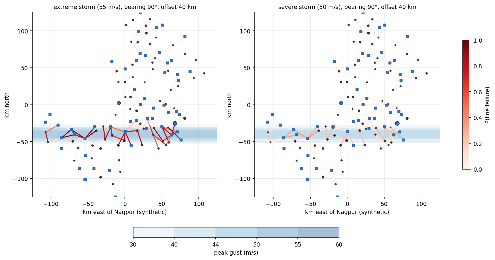

# Grid Stress Test: Nagpur

**Contingency analysis, climate heat derating and cascading impacts on critical services, with solar-plus-battery mitigation**

How do hazard outages and future heat stress a power grid, and how far do the failures spread into health and water services? This project answers the question for **Nagpur, Maharashtra**. The workflow is reproducible and built on open-source Python tools and open data: N-1/N-k contingency analysis, IEEE 738 conductor derating driven by 30 CMIP6 climate models, a power → water → hospital dependency graph built from OpenStreetMap and WorldPop, and survival-based sizing of PV + battery backup.



---

## Key findings

| Module | Result |
|---|---|
| **3A: N-1 (IEEE 118-bus, 186 elements)** | 40 contingencies violate limits (31 thermal, 12 voltage, 9 islanding). Only 4 force load shedding; the most critical is transformer T12 (115–67) at **84 MW** load at risk. |
| **3A: Storm N-k (500-run Monte Carlo)** | Extreme windstorm (55 m/s): about 26 lines fail, mean load at risk **138 MW** (max 237 MW), about **53 h** crew-limited restoration, about 4,700 MWh unserved per event. Severe storm (50 m/s): 7 lines fail, 95th percentile 80 MW. |
| **3B: Distribution feeder (CIGRE MV)** | Rooftop PV yields about 1,400 kWh/kWp/yr (NASA POWER + pvlib). Hosting capacity is about **2.2× peak load (~11 MW)**, limited by voltage rise (2.3×) and then cable loading (2.6×). Every section outage can be restored by tie switches. |
| **3C: Heat derating (30 CMIP6 models)** | Design hot-day Tmax 46.4 °C rises by **+1.7 °C (SSP2-4.5)** and **+2.6 °C (SSP5-8.5)** by 2041–2070. ACSR Zebra ampacity falls **3.5% / 6.1%** (median), and up to **9.8%** in hotter models. N-1 violations rise from **40 → 46**, reaching **54** with heat-driven demand growth; total post-contingency overload more than doubles. |
| **3D: Cascades (445 hospitals, 14 water nodes, 2.71 M people)** | An extreme storm costs about **515 critical service-hours per event** (95th percentile 923; up to 27 hospitals). Raising diesel autonomy at small hospitals from 4 h to 24 h cuts losses by about **two-thirds**. Water-mediated cascades account for about 6% of hospital-hours. |
| **3E: PV + battery mitigation** | See `results/05_mitigation/` (survival-based sizing against the 54 h design outage; cost per service-hour avoided, energy savings and CO₂ co-benefits). |

---

## Repository structure

```
grid-stress-nagpur/
├── notebooks/                       Google Colab notebooks, run in order
│   ├── 01_contingency_n1_nk.ipynb       3A  N-1, storm-corridor N-k, load at risk, restoration
│   ├── 02_cigre_mv_rooftop_pv.ipynb     3B  CIGRE MV feeder, rooftop PV hosting capacity
│   ├── 03_heat_derating_ieee738.ipynb   3C  IEEE 738 + NEX-GDDP-CMIP6 (Earth Engine), N-1 rerun
│   ├── 04_cascade_power_water_health.ipynb  3D  OSM + WorldPop, NetworkX dependency graph
│   └── 05_pv_battery_mitigation.ipynb   3E  PV + battery sizing, cost-effectiveness
├── src/                             Core functions as importable modules
│   ├── grid_contingency.py              DC-OPF load shedding, AC contingency screening
│   ├── storm_hazard.py                  wind footprint, fragility, restoration
│   ├── ieee738.py                       conductor heat balance (validated: 1025 A Drake example)
│   ├── pv_model.py                      pvlib chain for rooftop PV
│   └── cascade.py                       power → water → hospital dependency model
├── results/                         Tables (CSV/JSON) and figures from each notebook
├── docs/
│   └── literature_review.md
├── requirements.txt
└── LICENSE
```

## Methods

| Step | Method | Tools / data |
|---|---|---|
| Base case & N-1 | AC Newton-Raphson power flow; overloads, voltage violations, islanding; Ejebe–Wollenberg performance index | pandapower, IEEE 118-bus |
| Load at risk | DC optimal power flow with sheddable loads (linear programme), validated against pandapower DC flows | SciPy / HiGHS |
| Hazard N-k | storm track with Gaussian gust field; lognormal tower fragility; Monte Carlo; greedy crew-limited restoration | IS 875 wind speed |
| Feeder & PV | Erbs, Hay–Davies, SAPM, PVWatts; hosting-capacity sweep; tie-switch reconfiguration | pvlib, NASA POWER, CIGRE MV |
| Heat derating | IEEE 738-2012 heat balance written from scratch; 99th-percentile hot-day conditions per model; derated ratings applied to N-1 | NEX-GDDP-CMIP6 via Google Earth Engine |
| Cascades | directed dependency graph (bus → pump → hospital / water zone), hourly simulation with storage and diesel buffers | NetworkX, OpenStreetMap, WorldPop |
| Mitigation | outage survival over 20 years of hourly solar; least-cost PV + battery; benefit via the cascade model | NASA POWER, MNRE benchmark costs |

## How to run

1. Register a Google Cloud project for Earth Engine (non-commercial) at <https://code.earthengine.google.com/register> and set `PROJECT_ID` in the first code cell of each notebook.
2. Open the notebooks in Google Colab in order 01 → 05. Results are shared through `MyDrive/grid_stress_nagpur/`.
3. External data (NASA POWER, CMIP6, OSM, WorldPop) is downloaded and cached on the first run.

## Framework links

- **Sendai Framework:** Target D (disruption of basic services: power, health, water); Priority 4 (Build Back Better).
- **SDGs:** 7.1, 9.1, 3.
- **Paris Agreement:** adaptation, plus mitigation co-benefits (avoided CO₂ from PV).

## Limitations

- IEEE and CIGRE test networks, not Nagpur's real grid. Thermal ratings and geographic placement of the 118-bus case are synthetic.
- **The mapping of facilities to grid buses is synthetic.** Facility locations (OSM) and population (WorldPop) are real.
- DC-OPF load shedding assumes corrective re-dispatch. Storm fragility, restoration and buffer parameters are illustrative.
- Steady-state IEEE 738 rating for a single conductor type (ACSR Zebra, approximate resistances).
- Assumed essential loads and costs in the mitigation module.

## Data and licences

NASA POWER (NASA LaRC) · NEX-GDDP-CMIP6 (NASA NCCS, Thrasher et al., 2022) · OpenStreetMap contributors (ODbL) · WorldPop (CC BY 4.0) · pandapower test networks (BSD). Code: MIT licence.
